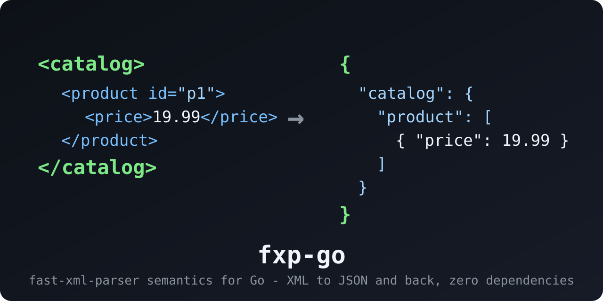

# fxp-go



**The XML your dependencies actually send you is not the XML `encoding/xml` wants.**

Real feeds are schema-less, attribute-heavy, mixed-content, occasionally malformed, and different every quarter. Writing one Go struct per feed is the tax you pay for every SOAP service, RSS variant, `pom.xml`, Android manifest, and K8s CRD you touch. JavaScript engineers solved this years ago with fast-xml-parser: XML in, plain object out, no schema.

fxp-go is that engine in pure Go. XML to JSON-compatible maps and back, order-preserving when you need it, tolerant when the feed is messy, differentially pinned to fast-xml-parser v5.12.1 with 83 golden fixtures generated from the JS engine itself.

```
go get github.com/ofershap/fxp-go
```

Zero dependencies. MIT licensed. Stdlib only.

## Parse

```go
p := fxp.New(fxp.DefaultOptions())
v, err := p.Parse(`<catalog><product id="p1"><name>Widget</name><price>19.99</price></product><product id="p2"><name>Gadget</name><price>9.99</price></product></catalog>`)
// {"catalog":{"product":[{"name":"Widget","price":19.99},{"name":"Gadget","price":9.99}]}}
```

Attributes are one option away:

```go
o := fxp.DefaultOptions()
o.IgnoreAttributes = false
v, _ := fxp.New(o).Parse(`<product id="p1" stock="5"><name>Widget</name></product>`)
// {"product":{"@_id":"p1","@_stock":"5","name":"Widget"}}
```

Output values are `string`, `float64`, `bool`, `map[string]any`, or `[]any`, so `encoding/json` marshals them directly. Numbers and booleans convert the way the JS engine converts them (`"0x1A"` -> `26`, `"0123"` -> `123`, `"Infinity"` stays a string).

## Build

```go
xml, _ := fxp.NewBuilder(fxp.DefaultBuildOptions()).Build(v)
// <product id="p1" stock="5"><name>Widget</name></product>
```

The builder escapes text and attribute values, renders CDATA and comment properties, and understands declarations and processing instructions. Because Go maps are unordered, sibling keys build in sorted order (deterministic across runs); the JS builder preserves insertion order instead. Roundtrip fidelity is verified semantically: every golden is built by both engines, re-parsed, and deep-compared.

## Validate

```go
err := fxp.Validate(`<a><b></a>`)
// fxp: expected closing tag </b> (opened line 1), got </a> (line 1)
```

Strict well-formedness checking (tag balance, attribute quoting, tag names) independent of the tolerant parser.

## Preserve order

```go
o := fxp.DefaultOptions()
o.IgnoreAttributes = false
o.PreserveOrder = true
v, _ := fxp.New(o).Parse(`<p>Hello <b>world</b>!</p>`)
// [{"p":[{"#text":"Hello"},{"b":[{"#text":"world"}]},{"#text":"!"}]}]
```

Child order survives, which is what HTML-ish XML, document transforms, and mixed content need.

## Option surface

26 of the 32 documented fast-xml-parser v5.x parse options are implemented and differentially tested: `allowBooleanAttributes`, `alwaysCreateTextNode`, `attributesGroupName`, `attributeNamePrefix`, `attributeValueProcessor`, `cdataPropName`, `commentPropName`, `htmlEntities`, `ignoreAttributes`, `ignoreDeclaration`, `ignorePiTags`, `isArray`, `maxNestedTags`, `parseAttributeValue`, `parseTagValue`, `parseTrueNumberOnly` (no observable difference from defaults on tested inputs), `preserveOrder`, `processEntities`, `removeNSPrefix`, `stopNodes`, `textNodeName`, `transformAttributeName`, `transformTagName`, `trimValues`, `unpairedTags`, `updateTag`.

The six not implemented: `entityDecoder` (custom decoder callback), `jPath` (jpath-shaped output), `numberParseOptions` (fine-grained knobs; defaults matched), `captureMetaData` (byte offsets), `onDangerousProperty` and `strictReservedNames` (JS prototype-pollution guards - Go maps have no prototype chain, so the hazard class they guard does not exist here).

## How it differs from the Go incumbents

| | fxp-go | encoding/xml | beevik/etree | dasel |
|---|---|---|---|---|
| Output without a schema | map/JSON directly | struct per schema | DOM nodes | query results |
| XML to JSON | yes | manual | manual | yes |
| Tolerant of malformed input | yes (differentially matched) | strict errors | partial | strict |
| Preserve child order | yes (option) | yes | yes | yes |
| JSON-shaped builder | yes | no | no | yes |
| Dependencies | zero | stdlib | zero | several |

Tested alternatives are named; no absence claims beyond this table. If your data has a stable schema and you control both ends, `encoding/xml` with structs is the right tool.

## Security

Verified in `security_test.go` and by fuzzing (600k+ generated inputs, zero panics):

- **Entity expansion is bounded.** DOCTYPE-defined entities are inserted literally and never re-expanded, so a billion-laughs chain cannot amplify. External DTDs are never fetched (there is no network code).
- **Nesting can be capped** with `MaxNestedTags`; a 2000-deep document parses when uncapped.
- **CDATA and stop-node content is never entity-decoded.**
- **Untrusted input:** the parser is tolerant by design and returns errors with line numbers on unrecoverable input; it does not panic. Treat parsed output as untrusted data (no output encoding is applied to map values). If input size is attacker-controlled, bound it before parsing - there are no input-size caps.
- Early-stage library; not independently audited.

## Performance

Scoped benchmark on a 3-product catalog document (see `bench_test.go`): ~16µs per parse on an ordinary CI machine, 209 allocations. `encoding/xml` cannot unmarshal into a map at all, so no apples-to-apples number exists; the comparison is workload shape, not speed claims.

## Differential testing

`testdata/gen/` contains the corpus (83 cases), the Node generator, the pinned `package-lock.json` for fast-xml-parser 5.12.1, and the generated goldens. `go test` compares Go output against the JS engine's byte-exact JSON. Regenerate with `node testdata/gen/gen.js` (requires Node; not needed to run the tests).

## FAQ

<details>
<summary><b>Why not just use encoding/xml?</b></summary>

It is the right tool when you control the schema. fxp-go is for the other case: feeds you do not control, prototypes, tooling, and pipelines where writing structs per document shape is the bottleneck. It also gives you the exact conversion semantics of fast-xml-parser, so catalogs and configs shared with a JS codebase behave identically.
</details>

<details>
<summary><b>Is it safe to parse untrusted XML?</b></summary>

The parser does not panic (fuzz-verified within a finite run: 600k+ inputs), never fetches external resources, caps entity expansion by construction, and can cap nesting depth. It is tolerant rather than strict - use `Validate` first if you need well-formedness guarantees. Bound input size yourself; there are no built-in size caps.
</details>

<details>
<summary><b>How exact is the fast-xml-parser parity?</b></summary>

83 golden fixtures generated from fast-xml-parser 5.12.1 compare byte-exact, including its quirks: numeric character references decode only with `htmlEntities`, each mixed text part trims individually before concatenation, grouped attributes keep their prefix, and stop-node content errors on `<` followed by a non-name character. One documented divergence: a bare `<` followed by a space outside stop nodes produces an empty-named element in the JS engine and a parse error in fxp-go.
</details>

<details>
<summary><b>Does it work with LLM/agent pipelines?</b></summary>

That is a common shape: tool results and function-call payloads arrive as XML (or XML-ish), and agents want JSON. `Parse` gives you JSON-marshalable maps with no schema work, and tolerant mode absorbs the malformed output models sometimes produce.
</details>

---

Built with [README Builder](https://github.com/ofershap/readme-builder). MIT © Ofer Shapira.
